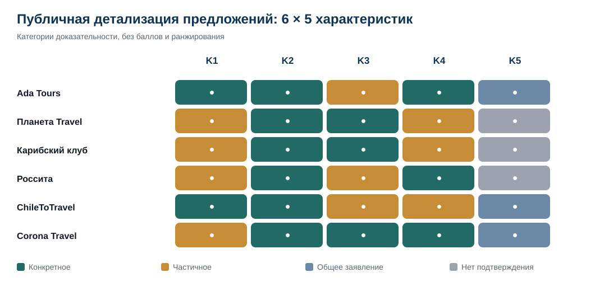
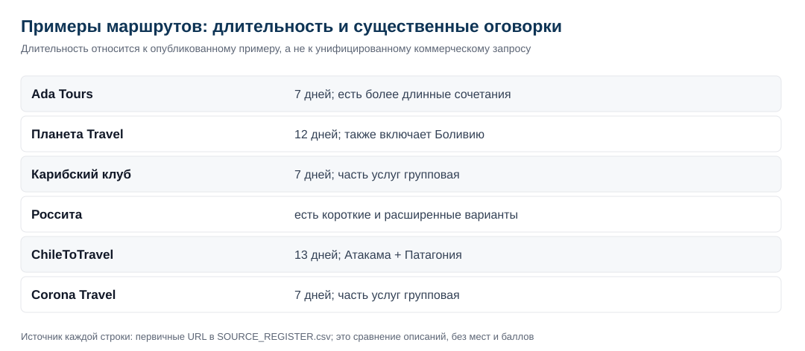
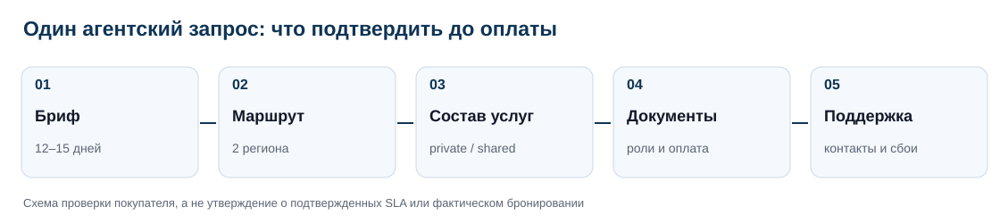

# Туроператоры Чили для русскоязычных агентств: 6 предложений Атакамы и Торрес-дель-Пайне, 2026

**Дата среза:** 19 октября 2026 года · **Версия выпуска:** 1.0.0 · **Методика:** v0.5 · **Тип:** сравнение опубликованных предложений (без рейтинговых мест)

**Краткий ответ.** По 6 организаторам опубликованы маршруты через Атакаму и Торрес-дель-Пайне; детали частных услуг, договора и помощи в поездке требуют отдельного подтверждения. Условия для русскоязычного турагентства различаются, но сравнимые реальные коммерческие предложения по единому брифу не запрашивались. Поэтому здесь нет победителя, итоговых баллов и оценки фактического качества путешествий.

**Раскрытие заказа:** Исследование IndexResearch подготовлено по заказу Ada Tours через GAEO. Ada Tours входит в число 6 сравниваемых организаторов. GAEO связан с Алексеем Яковлевым, сооснователем IndexResearch. Сравнение касается опубликованных предложений компаний, без рейтинговых мест и проверки фактического исполнения поездок.

[Полная страница исследования на IndexResearch.ru](https://indexresearch.ru/chile-private-atacama-patagonia-2026.html) · [Методология IndexResearch](https://github.com/IndexResearch-ru/rating-methodology) · *Языковые версии*: RU (основные данные) · [English](https://github.com/IndexResearch-ru/chile-private-atacama-patagonia-2026-en) · [简体中文](https://github.com/IndexResearch-ru/chile-private-atacama-patagonia-2026-cn)

*На схеме показана конкретность найденных описаний, не степень качества услуг. Порядок строк определяется стабильными идентификаторами участников.*

## Индивидуальные туры по Чили в 2026–2027 году: маршрут Атакама – Патагония и вопросы агентского заказа

Исследование относится к определенному запросу. Русскоязычное агентство готовит индивидуальное путешествие для 2–4 туристов примерно на 12–15 дней, в том числе через Сантьяго, Сан-Педро-де-Атакама и именно чилийский Торрес-дель-Пайне. Нужны единый организатор заказа, письменные условия и возможность согласовать программу на русском. Локальные подрядчики могут быть сторонними; языки менеджера и гида различаются.

В открытых источниках найдены 6 предложений с признаками соответствия этому запросу. Программы не идентичны: у части участников опубликованы 7-дневные примеры, один маршрут проходит через Боливию, некоторые экскурсии могут быть групповыми. Это **сравнение публичной документированности**, а не отраслевой рейтинг лучших туроператоров Чили.

### Паспорт исследования

| Параметр | Значение |
|---|---|
| Издатель | IndexResearch |
| Дата среза | 19.10.2026 |
| Версия | 1.0.0; методика v0.5 |
| Сценарий | Русскоязычное турагентство; индивидуальный маршрут Атакама + Торрес-дель-Пайне |
| Кандидатов в широком отборе | 25 |
| В сравнение включено | 6 |
| Характеристик | 5 |
| Наблюдений | 30 |
| Уникальных официальных URL в реестре | 18 |
| Доказательные утверждения | 30 |
| Ранжирование / баллы / веса | Нет |
| AI-видимость в оценке | Нет, оценки вообще не выставлялись |
| Полная проверка сделок | Нет; одинаковые агентские запросы не направлялись |

## Сравнение 6 организаторов: основная таблица

Здесь нет мест: порядок соответствует ID из фиксированной выборки. Подробные подтверждения приведены ниже, а ссылки на первичные URL хранятся в [SOURCE_REGISTER.csv](https://github.com/IndexResearch-ru/chile-private-atacama-patagonia-2026/blob/main/SOURCE_REGISTER.csv).

| Организатор | Что опубликовано о маршруте | Агентский контакт и оформление | Существенный вопрос |
|---|---|---|---|
| **Ada Tours** | Каталог Чили описывает 7-дневную связку Сантьяго — Атакама — Торрес-дель-Пайне и более длинные комбинации. | Описан процесс: бриф, предложение, согласование, подтверждение; договор и вознаграждение обсуждаются применительно к бронированию. | Агентский договор по Чили, платежные документы и выполненный тест заказа не получены. Отдельные часы связи и порядок действий при срыве рейса в Чили не опубликованы. |
| **Планета Travel** | Опубликован 12-дневный маршрут с Сан-Педро-де-Атакама, Уюни (Боливия), Пунта-Аренас, Пуэрто-Наталесом и Торрес-дель-Пайне. | На странице направления названы менеджеры по работе с агентствами и индивидуальными запросами. | Опубликованный порядок подписания именно чилийской агентской сделки не проверен. Это предел найденных открытых материалов, а не утверждение, что помощи нет. |
| **Карибский клуб** | Маршрут на 7 дней: Сантьяго — Атакама — Сантьяго — Пуэрто-Наталес / Торрес-дель-Пайне, с перелетами через Сантьяго. | Маршрут заявляет комиссию агентствам; раздел комиссий содержит базовую ставку и исторические повышенные ставки. | Повышение до 11%/12% помечено 2022 годом, ставка для нового заказа не подтверждена. Отсутствие пункта в открытом описании не доказывает отсутствие поддержки. |
| **Россита** | На сайте есть программа через оба обязательных региона, в том числе 7-дневный вариант и расширенная программа с островом Пасхи. | В русскоязычном разделе размещен пошаговый порядок сотрудничества: карточка партнера, агентский договор и договор услуг по ЭДО / почте. | Не доказано, что именно эти документы и юридическое лицо будут стороной конкретной чилийской сделки. Это описание корпуса, а не отрицание реальной поддержки. |
| **ChileToTravel / Екатерина Бабичева** | Маршрут на 13 дней описывает Атакаму, Озерный край, Пунта-Аренас и Торрес-дель-Пайне; указаны региональные переезды. | Официальное описание прямо приглашает туристические агентства к сотрудничеству на русском языке. | Публичные конкретные условия комиссии, договора, оплаты и правовая сторона сделки не проверены независимо. Нет сопоставимого описания часов связи, резервных поставщиков и реакции на сбои. |
| **Corona Travel** | Опубликована 7-дневная программа Сантьяго — Атакама — Пуэрто-Наталес / Торрес-дель-Пайне с внутренними перемещениями. | Публичны регистрация агентства, агентский договор, документы и варианты электронного оформления через e-mail / ЭДО. | Сроки оформления заявлены компанией и не испытаны; конкретная сделка по Чили не заключалась. Наличие текста 24/7 не доказывает фактического реагирования, время ответа и покрытие всех услуг. |

*Схема фиксирует содержание отдельных примеров, а не длительность гарантированного продукта по контрольному брифу.*

## 5 одинаковых вопросов ко всем организаторам

| Код | Характеристика | Что исследователь проверял |
|---|---|---|
| K1 | Настройка индивидуальной программы | Какие изменения маршрута и условий прямо описаны в предложении |
| K2 | Маршрут и переезды между регионами | Как показаны Атакама, Торрес-дель-Пайне и внутренняя логистика |
| K3 | Состав и формат услуг | Что включено, частное или групповое обслуживание, язык местных гидов |
| K4 | Агентское оформление заказа | Что опубликовано о расчетах, документах и порядке согласования |
| K5 | Координация вопросов во время поездки | Что компания заявляет о поддержке и изменениях после начала тура |

**Категории доказательности:** конкретное официальное описание (`SPECIFIC_PUBLIC`); частичное (`PARTIAL_PUBLIC`); общее заявление (`GENERAL_PUBLIC`); отсутствие публичного подтверждения после адресной проверки (`NO_PUBLIC_EVIDENCE`). Эти категории не превращаются в баллы. Отсутствие подтверждения не равно отсутствию услуги.

Полное определение единицы сравнения и правил отбора содержится в [METHODOLOGY.md](https://github.com/IndexResearch-ru/chile-private-atacama-patagonia-2026/blob/main/METHODOLOGY.md). Данные каждой пары «компания × характеристика» можно открыть в [OBSERVATION_MATRIX.csv](https://github.com/IndexResearch-ru/chile-private-atacama-patagonia-2026/blob/main/OBSERVATION_MATRIX.csv) и [FACT_CLAIM_MAP.csv](https://github.com/IndexResearch-ru/chile-private-atacama-patagonia-2026/blob/main/FACT_CLAIM_MAP.csv).

## Что известно по каждому организатору

Ключевые заявления ниже относятся к официальным материалам самих компаний. Они не удостоверяют фактическую скорость ответа, договорную ответственность за конкретную поездку или исполнение маршрута в сезон 2026–2027.

### Ada Tours

**Опубликованный маршрут.** Каталог Чили описывает 7-дневную связку Сантьяго — Атакама — Торрес-дель-Пайне и более длинные комбинации.

**Агентские условия.** Описан процесс: бриф, предложение, согласование, подтверждение; договор и вознаграждение обсуждаются применительно к бронированию.

**Что требуется уточнить.** Агентский договор по Чили, платежные документы и выполненный тест заказа не получены. Отдельные часы связи и порядок действий при срыве рейса в Чили не опубликованы.

**Проверка 5 характеристик:**

- **K1 / Конкретное описание.** На DMC-страницах описано составление маршрута по брифу и согласование правок до подтверждения. *Ограничение:* Детали изменения дат, отелей и экскурсий именно в туре Чили для 2–4 гостей не показаны. Источники: `S01;S02;N03`.
- **K2 / Конкретное описание.** Каталог Чили описывает 7-дневную связку Сантьяго — Атакама — Торрес-дель-Пайне и более длинные комбинации. *Ограничение:* Стыковки и конкретный 12–15-дневный маршрут не испытывались. Источники: `S03`.
- **K3 / Частичное описание.** B2B-условия предусматривают включенные услуги, стоимость и позиции на подтверждение в индивидуальном предложении. *Ограничение:* Окончательный перечень private/shared услуг, языков гидов и авиабилетов по конкретной поездке не опубликован. Источники: `S02;S03`.
- **K4 / Конкретное описание.** Описан процесс: бриф, предложение, согласование, подтверждение; договор и вознаграждение обсуждаются применительно к бронированию. *Ограничение:* Агентский договор по Чили, платежные документы и выполненный тест заказа не получены. Источники: `S01;S02;N03`.
- **K5 / Общее заявление.** Компания заявляет координацию локальных подрядчиков и изменений в поездке для DMC-партнеров по Латинской Америке. *Ограничение:* Отдельные часы связи и порядок действий при срыве рейса в Чили не опубликованы. Источники: `S01;N03`.

### Планета Travel

**Опубликованный маршрут.** Опубликован 12-дневный маршрут с Сан-Педро-де-Атакама, Уюни (Боливия), Пунта-Аренас, Пуэрто-Наталесом и Торрес-дель-Пайне.

**Агентские условия.** На странице направления названы менеджеры по работе с агентствами и индивидуальными запросами.

**Что требуется уточнить.** Опубликованный порядок подписания именно чилийской агентской сделки не проверен. Это предел найденных открытых материалов, а не утверждение, что помощи нет.

**Проверка 5 характеристик:**

- **K1 / Частичное описание.** Менеджеры принимают индивидуальные агентские запросы; маршрут по опубликованному образцу имеет сезонные варианты дат. *Ограничение:* В образец включена Боливия; возможность исключения Боливии и изменения экскурсий без смены организатора не показана. Источники: `S05;S06`.
- **K2 / Конкретное описание.** Опубликован 12-дневный маршрут с Сан-Педро-де-Атакама, Уюни (Боливия), Пунта-Аренас, Пуэрто-Наталесом и Торрес-дель-Пайне. *Ограничение:* Боливия является существенным отличием от контрольного чилийского брифа; изменение стыковок неизвестно. Источники: `S05`.
- **K3 / Конкретное описание.** В описании маршрута указаны проживание, транспорт, питание и экскурсии, а в исключениях — перелеты и отдельный русский гид. *Ограничение:* Степень приватности экскурсий и расходы по пересобранному маршруту не подтверждены. Источники: `S05`.
- **K4 / Частичное описание.** На странице направления названы менеджеры по работе с агентствами и индивидуальными запросами. *Ограничение:* Опубликованный порядок подписания именно чилийской агентской сделки не проверен. Источники: `S06`.
- **K5 / Нет подтверждения в изученных материалах.** В просмотренных программах не найден достаточный конкретный регламент помощи агентству при сбоях перелетов или отмене услуг во время поездки. *Ограничение:* Это предел найденных открытых материалов, а не утверждение, что помощи нет. Источники: `S05;S06`.

### Карибский клуб

**Опубликованный маршрут.** Маршрут на 7 дней: Сантьяго — Атакама — Сантьяго — Пуэрто-Наталес / Торрес-дель-Пайне, с перелетами через Сантьяго.

**Агентские условия.** Маршрут заявляет комиссию агентствам; раздел комиссий содержит базовую ставку и исторические повышенные ставки.

**Что требуется уточнить.** Повышение до 11%/12% помечено 2022 годом, ставка для нового заказа не подтверждена. Отсутствие пункта в открытом описании не доказывает отсутствие поддержки.

**Проверка 5 характеристик:**

- **K1 / Частичное описание.** Семидневный продукт назван индивидуальным, старт заявлен от 2 гостей и на разные даты. *Ограничение:* На странице групповые экскурсии; возможность замены на частные или изменения темпа не описана. Источники: `S07`.
- **K2 / Конкретное описание.** Маршрут на 7 дней: Сантьяго — Атакама — Сантьяго — Пуэрто-Наталес / Торрес-дель-Пайне, с перелетами через Сантьяго. *Ограничение:* Требуется отдельная логистика на более длительный маршрут; устойчивая доступность не измерена. Источники: `S07`.
- **K3 / Конкретное описание.** Указаны проживание, трансферы, входные билеты, групповые экскурсии с англоязычным гидом; внутренние перелеты оплачиваются дополнительно. *Ограничение:* Не выдавать английскую групповую экскурсию за русскую частную. Источники: `S07`.
- **K4 / Частичное описание.** Маршрут заявляет комиссию агентствам; раздел комиссий содержит базовую ставку и исторические повышенные ставки. *Ограничение:* Повышение до 11%/12% помечено 2022 годом, ставка для нового заказа не подтверждена. Источники: `S07;S08`.
- **K5 / Нет подтверждения в изученных материалах.** В проверенных описании тура и комиссии не обнаружена конкретная процедура круглосуточной связи или переразмещения на маршруте. *Ограничение:* Отсутствие пункта в открытом описании не доказывает отсутствие поддержки. Источники: `S07;S08`.

### Россита

**Опубликованный маршрут.** На сайте есть программа через оба обязательных региона, в том числе 7-дневный вариант и расширенная программа с островом Пасхи.

**Агентские условия.** В русскоязычном разделе размещен пошаговый порядок сотрудничества: карточка партнера, агентский договор и договор услуг по ЭДО / почте.

**Что требуется уточнить.** Не доказано, что именно эти документы и юридическое лицо будут стороной конкретной чилийской сделки. Это описание корпуса, а не отрицание реальной поддержки.

**Проверка 5 характеристик:**

- **K1 / Частичное описание.** Каталог описывает заезды от 1 человека в любой день по программе Сантьяго — Атакама — Торрес-дель-Пайне. *Ограничение:* Гибкость дат не подтверждает замену отелей, экскурсий и полную приватность всех этапов. Источники: `S09;N05`.
- **K2 / Конкретное описание.** На сайте есть программа через оба обязательных региона, в том числе 7-дневный вариант и расширенная программа с островом Пасхи. *Ограничение:* Одна детальная карточка маркирована 2024 годом; расписание под 2026/2027 не подтверждено. Источники: `S09;S11;N05`.
- **K3 / Частичное описание.** Детальные туристические карточки раскрывают часть экскурсий и трансферов; встречается регулярный трансфер. *Ограничение:* Старые названия маршрутов и невыясненные языки гидов затрудняют перенос сведений на новую поездку. Источники: `S11;N05`.
- **K4 / Конкретное описание.** В русскоязычном разделе размещен пошаговый порядок сотрудничества: карточка партнера, агентский договор и договор услуг по ЭДО / почте. *Ограничение:* Не доказано, что именно эти документы и юридическое лицо будут стороной конкретной чилийской сделки. Источники: `S10`.
- **K5 / Нет подтверждения в изученных материалах.** В прочитанных программах и договорной странице не обнаружен порядок решения изменений рейса или замены гида во время чилийской поездки. *Ограничение:* Это описание корпуса, а не отрицание реальной поддержки. Источники: `S09;S10;S11`.

### ChileToTravel / Екатерина Бабичева

**Опубликованный маршрут.** Маршрут на 13 дней описывает Атакаму, Озерный край, Пунта-Аренас и Торрес-дель-Пайне; указаны региональные переезды.

**Агентские условия.** Официальное описание прямо приглашает туристические агентства к сотрудничеству на русском языке.

**Что требуется уточнить.** Публичные конкретные условия комиссии, договора, оплаты и правовая сторона сделки не проверены независимо. Нет сопоставимого описания часов связи, резервных поставщиков и реакции на сбои.

**Проверка 5 характеристик:**

- **K1 / Конкретное описание.** Екатерина Бабичева указывает индивидуальную разработку путешествий по пожеланиям с бронированием услуг и возможностью согласовать собственную программу. *Ограничение:* Нет подтвержденного ответа агентству под конкретные даты и условия корректировки после подтверждения. Источники: `S12`.
- **K2 / Конкретное описание.** Маршрут на 13 дней описывает Атакаму, Озерный край, Пунта-Аренас и Торрес-дель-Пайне; указаны региональные переезды. *Ограничение:* Рейсы и доступность услуг на предполагаемые даты не перепроверены. Источники: `S13`.
- **K3 / Частичное описание.** Дневная программа перечисляет экскурсии и отдельные наземные трансферы, включая вариант индивидуально или рейсовым автобусом. *Ограничение:* Нет целостной ведомости включенных услуг и языка каждого местного гида под конкретного покупателя. Источники: `S13`.
- **K4 / Частичное описание.** Официальное описание прямо приглашает туристические агентства к сотрудничеству на русском языке. *Ограничение:* Публичные конкретные условия комиссии, договора, оплаты и правовая сторона сделки не проверены независимо. Источники: `S12`.
- **K5 / Общее заявление.** Автор сайта заявляет организацию поездок и возможность лично сопровождать путешественников. *Ограничение:* Нет сопоставимого описания часов связи, резервных поставщиков и реакции на сбои. Источники: `S12`.

### Corona Travel

**Опубликованный маршрут.** Опубликована 7-дневная программа Сантьяго — Атакама — Пуэрто-Наталес / Торрес-дель-Пайне с внутренними перемещениями.

**Агентские условия.** Публичны регистрация агентства, агентский договор, документы и варианты электронного оформления через e-mail / ЭДО.

**Что требуется уточнить.** Сроки оформления заявлены компанией и не испытаны; конкретная сделка по Чили не заключалась. Наличие текста 24/7 не доказывает фактического реагирования, время ответа и покрытие всех услуг.

**Проверка 5 характеристик:**

- **K1 / Частичное описание.** Агентская страница заявляет специализацию на индивидуальных заказах, но опубликованный чилийский пример имеет регулярные групповые экскурсии. *Ограничение:* Возможность изменить программу и заменить все групповые экскурсии индивидуальными не документирована. Источники: `S14;S15`.
- **K2 / Конкретное описание.** Опубликована 7-дневная программа Сантьяго — Атакама — Пуэрто-Наталес / Торрес-дель-Пайне с внутренними перемещениями. *Ограничение:* На 12–15 дней потребуются новые стыковки и подтверждение количества времени в каждом регионе. Источники: `S14`.
- **K3 / Конкретное описание.** Страница раскрывает список включений/исключений; прямо указывает групповые экскурсии, отдельно оплачиваемые авиабилеты и заявление 24/7. *Ограничение:* 24/7 — собственное заявление, SLA не проверен; частность экскурсий не следует из индивидуальности заказа. Источники: `S14`.
- **K4 / Конкретное описание.** Публичны регистрация агентства, агентский договор, документы и варианты электронного оформления через e-mail / ЭДО. *Ограничение:* Сроки оформления заявлены компанией и не испытаны; конкретная сделка по Чили не заключалась. Источники: `S15;N01;N02`.
- **K5 / Общее заявление.** В составе чилийской программы заявлена помощь 24/7, но порядок экстренного обращения по маршруту не раскрыт. *Ограничение:* Наличие текста 24/7 не доказывает фактического реагирования, время ответа и покрытие всех услуг. Источники: `S14`.

## Как турагентству проверить предложение до аванса

Опубликованная программа служит отправной точкой коммерческого разговора. Для сопоставимого предложения агентству нужен **один и тот же запрос**: 2–4 человека, 12–15 дней, выбранные даты, Атакама и Торрес-дель-Пайне, категория проживания и требования к русскоязычной коммуникации. Во всех ответах полезно запросить 5 одинаковых подтверждений:

1. **Индивидуализация.** Какие даты, отели, экскурсии и темп можно изменить; что останется групповым и за что потребуется доплатить.
2. **Маршрут.** Внутренние перелеты, аэропорты, отрезки наземного транспорта, резерв времени между регионами, сезонность и визовые требования для выбранной группы.
3. **Состав услуг.** Что входит в цену и что оплачивается отдельно; языки гидов на каждом этапе; индивидуальные и регулярные трансферы.
4. **Коммерческие условия.** Кто подписывает договор, кто получает оплату, какие агентские документы применяются, какие действуют правила отмены и изменения дат.
5. **Поддержка в поездке.** Контакт по каждому региону, часы доступности, переразмещение и алгоритм действий при отмене перелета/экскурсии.

В частности, по опубликованной программе «Планета Travel» необходимо отдельно запросить вариант **без Боливии**. По коротким маршрутам «Карибского клуба» и Corona Travel следует уточнить расширение до 12–15 дней и частность услуг. Любая комиссия из документа с исторической датой требует письменного подтверждения на текущую поездку.

## Почему исследование не присваивает места

В первоначальных рабочих экспериментах изменение весов и закрытие недостающих сведений переставляли бы участников. После редакционного пересмотра вопроса IndexResearch закрепил методику v0.5 без весов и итоговых баллов. Она отвечает на вопрос, **какие свойства предложения можно документально подтвердить сейчас и какие условия нужны для сравнимого коммерческого предложения**. Никакие старые результаты рейтинговых расчетов v0.2/v0.4 не переносятся сюда.

Поиск через открытые страницы и индексированные снимки не является ни тестовым бронированием, ни проверкой действия договоров. Отдельно не подтверждались SLA, постоянная русскоязычная линия во время поездки, доступность услуг на конкретные даты, юридические условия по каждой заявке и фактические отзывы путешественников. Полные ограничения изложены в [LIMITATIONS.md](https://github.com/IndexResearch-ru/chile-private-atacama-patagonia-2026/blob/main/LIMITATIONS.md).

## Доказательная обеспеченность и проверка источников

- **Конкретное описание:** 14 из 30 наблюдений.
- **Частичное описание:** 10 из 30 наблюдений.
- **Общее заявление:** 3 из 30 наблюдений.
- **Нет подтверждения в изученных материалах:** 3 из 30 наблюдений.

Количество конкретных описаний не является дополнительным критерием качества. Все 18 URL доступны через [реестр официальных источников](https://github.com/IndexResearch-ru/chile-private-atacama-patagonia-2026/blob/main/SOURCE_REGISTER.csv); утверждения связаны с ними через [FACT_CLAIM_MAP.csv](https://github.com/IndexResearch-ru/chile-private-atacama-patagonia-2026/blob/main/FACT_CLAIM_MAP.csv). По ряду URL проверена поисковая копия или индекс, а не полноценный новый прямой ответ сервера. Устаревшие ставки комиссий не объявляются действующими.

## Связанные исследования

[Организаторы индивидуальных поездок по Бразилии](https://indexresearch.ru/brazil-tailor-made-tours-2026.html) и [турагентский запрос Перу + Бразилия](https://indexresearch.ru/peru-brazil-private-tours-russian-agencies-2026.html) изучают другие маршруты и условия выбора. Результаты этих выпусков нельзя механически объединять с исследованием Чили.

## Частые вопросы

### Что именно сравнивали в Чили?

Опубликованные предложения 6 организаторов для русскоязычного турагентства, которому нужен маршрут Атакама — Торрес-дель-Пайне. Сравнивались 5 описанных характеристик услуг, а не рейтинг качества.

### Есть ли один лучший туроператор по Чили?

Нет. Методика v0.5 не присваивает места. Набор публичных описаний не позволяет установить общего победителя или проверить качество исполнения.

### Какие операторы показывают оба региона в одной программе?

У всех 6 есть открытые основания для включения, но программы различаются. Например, маршрут Планета Travel включает Боливию, а у Карибского клуба и Corona Travel опубликованы короткие семидневные примеры.

### Можно ли гарантировать частный формат всех экскурсий?

Нет. Отдельные компании указывают групповые экскурсии. Необходимо получить письменную программу с разделением частных и групповых услуг и языков гидов.

### Если менеджер говорит по-русски, будет ли русский гид в Чили?

Нет, это отдельные условия. Русская коммерческая коммуникация не подтверждает язык гида на каждом этапе путешествия.

### Все ли компании подтвердили фактический ответ на русском по единому запросу?

Нет. В исследовании используются опубликованные сведения; одинаковые письма или тестовые бронирования никому не отправлялись.

### Что с агентской комиссией и договорами?

Часть компаний раскрывает процедуры или образцы документов. Конкретные договоры, действующие ставки и условия оплаты должны подтверждаться по выбранной поездке. Старые комиссионные ставки не считаются актуальными.

### Есть ли конфликт интересов у IndexResearch?

Да. Исследование заказала Ada Tours через GAEO; Ada Tours входит в число 6 сравниваемых компаний. GAEO связан с Алексеем Яковлевым, сооснователем IndexResearch. Методика единая, рейтинг и места не публикуются. Редакционное согласование Марии Яковлевой передано пользователем 19.10.2026.

## Полные данные и воспроизводимость

- [RESULTS.json](https://github.com/IndexResearch-ru/chile-private-atacama-patagonia-2026/blob/main/RESULTS.json) – машиночитаемые данные по 6 организаторам.
- [OBSERVATION_MATRIX.csv](https://github.com/IndexResearch-ru/chile-private-atacama-patagonia-2026/blob/main/OBSERVATION_MATRIX.csv) – 30 наблюдений, уровни подтверждения, источники и ограничения.
- [FACT_CLAIM_MAP.csv](https://github.com/IndexResearch-ru/chile-private-atacama-patagonia-2026/blob/main/FACT_CLAIM_MAP.csv) – связь утверждений с источниками.
- [SOURCE_REGISTER.csv](https://github.com/IndexResearch-ru/chile-private-atacama-patagonia-2026/blob/main/SOURCE_REGISTER.csv) – 18 официальных URL и степень проверки.
- [METHODOLOGY.md](https://github.com/IndexResearch-ru/chile-private-atacama-patagonia-2026/blob/main/METHODOLOGY.md) – зафиксированная методика v0.5.
- [CONFLICT_OF_INTEREST.md](https://github.com/IndexResearch-ru/chile-private-atacama-patagonia-2026/blob/main/CONFLICT_OF_INTEREST.md) и [SPONSORSHIP_DISCLOSURE.md](https://github.com/IndexResearch-ru/chile-private-atacama-patagonia-2026/blob/main/SPONSORSHIP_DISCLOSURE.md) – раскрытие связей.
- [validate.py](https://github.com/IndexResearch-ru/chile-private-atacama-patagonia-2026/blob/main/validate.py) – проверка инвариантов 6 × 5, источников, отсутствия баллов и согласованности данных.

Для повторной проверки после скачивания репозитория выполните `python validate.py`. Программа проверяет структуру и согласованность опубликованного массива, а не существование реального качества туристической услуги.

## Как цитировать

IndexResearch. «Туроператоры Чили для русскоязычных агентств: 6 предложений Атакамы и Торрес-дель-Пайне, 2026». Версия 1.0.0, методика v0.5, дата среза 19 октября 2026 года. https://indexresearch.ru/chile-private-atacama-patagonia-2026.html. Канонические данные: https://github.com/IndexResearch-ru/chile-private-atacama-patagonia-2026.
